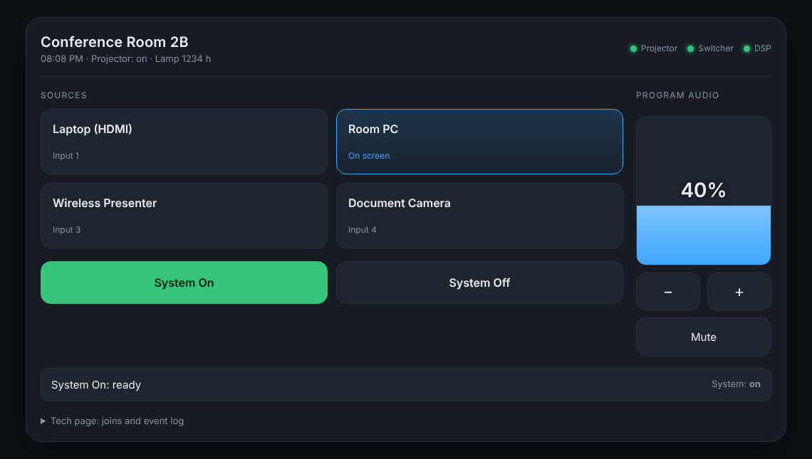
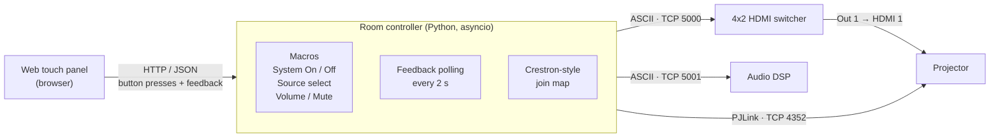

# AV Room Control Simulator

A Python control system for a conference room: it runs a **projector, matrix switcher and audio DSP** over TCP/IP, with **room macros**, **live feedback**, and a **web touch panel**. It also includes a **Crestron SIMPL# Pro** reference program that uses the same join map and commands.

The devices are simulated, so it runs on any laptop with no hardware. Point `config.json` at real gear, and the PJLink driver will control a real projector.



## Why I built this

A Crestron processor's day job is talking to third-party devices: open a TCP socket, send a command, parse the reply, handle the device going offline, and keep the touch panel feedback honest. This project rebuilds that whole stack in Python so it can be run, tested and read without a processor or a Crestron license.

## Architecture



**Signal flow:** Laptop, Room PC, Wireless and Doc Cam go into switcher inputs 1-4. Output 1 feeds the projector (HDMI 1, PJLink input `31`), output 2 feeds a confidence monitor, and program audio is handled by the DSP.

## Quick start

Requires Python 3.10+, with no packages to install.

```bash
git clone https://github.com/mohammedbafagih45-max/av-room-control.git
cd av-room-control
python run.py
```

Open **http://127.0.0.1:8080** and press **System On**.

```bash
python run.py --verbose          # log every command on the wire (great for demos)
python run.py --no-sim           # control the real devices in config.json
python -m unittest -v            # run the test suite
```

You can also talk to the simulated devices by hand, just like testing gear with PuTTY or Crestron Toolbox:

```bash
nc 127.0.0.1 4352        # then type:  %1POWR ?
nc 127.0.0.1 5000        # then type:  ROUTE 2 1
```

## What the macros do

| Macro | Steps |
|---|---|
| **System On** | Mute audio (no speaker pop), then projector `POWR 1`, then poll until warm-up finishes, then `INPT 31`, then route the default source to both outputs, then set volume to 40%, then unmute |
| **System Off** | Mute audio, then projector `POWR 0`, then poll until cool-down finishes |
| **Source press** | Route to both outputs. If the room is off, it runs System On with that source first |
| **Volume / Mute** | Step 5%, and unmute on any volume change |

Design decisions that mirror real-world programming:

- **One dead device doesn't kill the macro.** If the DSP is offline, the projector still comes up, and the error is logged and shown on the panel.
- **Commands are serialized per device** with a lock and a timeout, and the socket reconnects once before the device is marked offline.
- **Respects device timing.** PJLink rejects input changes during warm-up (`ERR3`), so the macro waits for real power feedback instead of guessing with a fixed delay.
- **No double-presses.** A second System On while one is running is ignored.
- **Feedback comes from the devices, not from button presses.** If someone uses the projector's IR remote, the panel catches up on the next poll.

## Crestron join map

The panel's **Tech page** shows these joins live. `crestron/ControlSystem.cs` uses the same numbers.

| Join | Type | Direction | Function |
|---|---|---|---|
| D1 | Digital | press / fb | System On |
| D2 | Digital | press / fb | System Off |
| D3 | Digital | fb | Projector warming |
| D4 | Digital | fb | Projector cooling |
| D5 / D6 | Digital | press | Volume up / down |
| D7 | Digital | press / fb | Mute toggle |
| D11-D14 | Digital | press / fb | Source 1-4 select (interlocked) |
| D21-D23 | Digital | fb | Projector / switcher / DSP online |
| A1 | Analog | fb | Volume (0-65535) |
| A2 | Analog | fb | Lamp hours |
| S1 | Serial | fb | Room name |
| S2 | Serial | fb | Status text |
| S3 | Serial | fb | Current source name |

## Device protocols

**Projector: PJLink Class 1** (an open standard supported by Epson, NEC/Sharp, Panasonic, Sony, Christie and others). Commands end in CR.

| Command | Meaning | Reply |
|---|---|---|
| `%1POWR 1` / `0` | Power on / off | `%1POWR=OK` |
| `%1POWR ?` | Power state | `0` off, `1` on, `2` cooling, `3` warming |
| `%1INPT 31` | Select HDMI 1 | `OK` or `ERR3` while warming |
| `%1AVMT 31` / `30` | A/V mute on / off | `OK` |
| `%1LAMP ?` | Lamp hours | `1234 1` |

PJLink authentication (MD5 digest) is supported on both the driver and the simulator.

**Switcher (ASCII, CR/LF):** `ROUTE <in> <out>`, `ROUTE? <out>`, `SIGNAL? <in>`, `VER?`
**DSP (ASCII, CR/LF):** `SET VOL <0-100>`, `GET VOL`, `SET MUTE <0|1>`, `GET MUTE`

## Project layout

```
avsim/
  devices/     simulated projector (PJLink), switcher, DSP: asyncio TCP servers
  drivers/     controller-side TCP drivers: timeouts, reconnect, error parsing
  room.py      macros, feedback polling, join map output
  joins.py     Crestron join numbers + 0-65535 analog scaling
  web/         touch panel (HTML/JS)
crestron/      SIMPL# Pro reference program (same joins and commands)
tests/         11 unit tests: protocols, auth, offline handling, macros
run.py         starts everything
config.json    IPs, ports, source names
```

## Crestron notes

`crestron/ControlSystem.cs` is a reference SIMPL# Pro program for a 4-Series processor and a TSW-770 panel. It is **not compiled in this repo**, since that needs the Crestron SDK. It shows how the same logic maps to the Crestron side: `TCPClient` for PJLink, `SigChange` for button presses, and `BooleanInput` / `UShortInput` / `StringInput` for feedback. With `run.py` running on a PC, a real processor could point `ProjectorIp` at that PC and control the simulated projector.

## Ideas for next steps

- Swap the generic switcher and DSP for real protocols (e.g. Biamp Tesira TTP, QSC Q-SYS QRC)
- Scheduled shutdown at 10 PM
- Lamp-hour and offline alerts by email or Teams webhook
- A RS-232 transport using `pyserial` for older gear

## License

MIT
